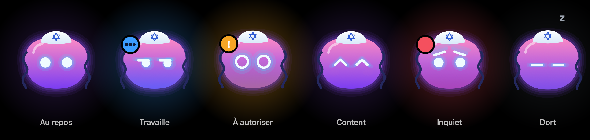
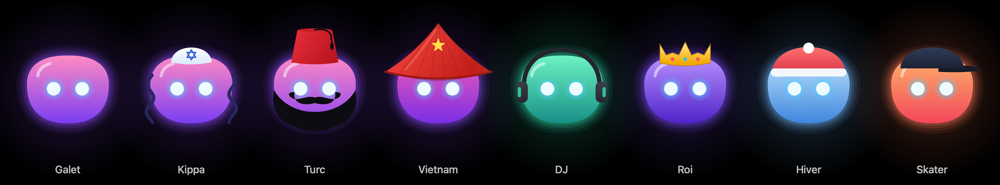

# Encoche

Un petit bonhomme qui vit dans l'encoche de ton Mac et garde un œil sur Claude Code pour toi.



## Ce qu'il fait

- **Suit tes sessions Claude Code** (VS Code ou terminal) : ce que Claude est en train de faire, quand il a fini, quand il attend.
- **Autorise ou refuse** les demandes de Claude depuis l'encoche, ou au clavier avec ⌥⇧Y / ⌥⇧N.
- **Réponds aux questions de Claude** (un clic sur ton choix) et **valide son plan** (ou demande des changements) sans ouvrir VS Code.
- **Jauge d'usage de ton abonnement Claude** : la session de 5 h et la semaine, et quand ça repart à zéro. Le bonhomme prévient à 80 %.
- **Sous-agents et mémoire** : combien d'agents travaillent, et quand Claude compresse sa mémoire.
- **Écris à Claude sans quitter ce que tu fais** : ⌥Espace ouvre l'encoche prête à écrire, ⌥⇧Espace pour dicter.
- **VS Code ou l'app Claude, au choix** : « + Nouveau » ouvre une conversation, une session Claude Code ou Cowork dans l'[app Claude](https://claude.ai/download) avec ton message déjà écrit, ou une session Claude Code dans VS Code. Projets récents et les Réglages retiennent où ouvrir les nouvelles sessions.
- **Prompts favoris** en un clic (« Continue », « Lance les tests »…), **choix du modèle**, et un **bilan de fin** : fichiers modifiés, lignes, tokens.
- **Étagère** pour garder des fichiers sous la main, **historique du presse-papiers**, **capture d'écran** envoyée à Claude.
- **Onglet Outils** :
  - **Terminal** : une commande dans le dossier d'un projet, le résultat en direct ;
  - **Serveurs · Mac** : tes serveurs locaux (ouvrir, arrêter), CPU, mémoire, batterie, AirPods ;
  - **Texte IA** : sélectionne un texte n'importe où, ⌥⇧R, et Claude le corrige, le reformule, le raccourcit ou le traduit (le résultat remplace ta sélection) ; un PDF de l'étagère se résume d'un clic droit ;
  - **Miroir** : ta caméra pour vérifier ta tête avant une visio ;
  - **Prompteur** : ton texte défile sous la caméra pour lire en regardant l'objectif.
- **Spotify** : le morceau en cours, lecture/pause, précédent/suivant, et les **paroles synchronisées** (LRCLIB).
- **AirPods** : leur batterie (écouteurs et boîtier) dès qu'ils se connectent. **AirDrop** depuis l'étagère.
- **Discrète** : l'encoche n'apparaît pas dans les captures et enregistrements d'écran (réglable). En partage d'écran (Zoom, Meet…), ça dépend de l'app : vérifie avant un appel important.
- **Rappels** : pause, verre d'eau, « va dormir »… Tout se coupe dans les Réglages.
- **Entre potes** : partagez un groupe, voyez les bonshommes des autres (et s'ils sont sur leur Mac), discutez dans le chat, envoyez-vous des cœurs.
- **Caméra entre potes** (si chacun l'active) : l'onglet Potes montre en direct ceux qui partagent leur caméra, image seulement, sans appel. Ta caméra ne s'allume que pendant qu'un pote regarde, et l'encoche te dit qui. L'image va directement d'un Mac à l'autre (sur certains réseaux, comme la 4G ou un Wi-Fi d'entreprise, ça ne passe pas).
- **Le plan de Claude** : sa liste de tâches, cochée au fur et à mesure.
- **Notifications sur ton téléphone** avec [ntfy](https://ntfy.sh), si tu veux (désactivé par défaut).

## Skins

Choisis le look de ton bonhomme et sa couleur dans les Réglages (ou clic droit sur lui). Tes potes voient le tien.



## Installer

Il te faut un Mac sous **macOS 14 (Sonoma) ou plus récent**, idéalement avec une encoche (sinon une encoche virtuelle apparaît en haut de l'écran), et **Claude Code**.

Colle ça dans le Terminal :

```sh
curl -fsSL https://raw.githubusercontent.com/minh54500/jarvisrael/main/install.sh | zsh
```

Le script télécharge le code, le compile sur ton Mac (1 à 2 minutes) et installe Encoche dans `~/Applications`. Si macOS te propose d'installer les « outils de développement », accepte, attends la fin, puis relance la commande.

> Pourquoi compiler ? L'app n'est pas signée par Apple : téléchargée toute faite, macOS la bloquerait. Compilée chez toi, elle s'ouvre normalement.

## Premier lancement

1. Survole l'encoche en haut de l'écran et clique **Brancher à Claude Code**. Encoche ajoute ses hooks dans `~/.claude/settings.json` (une sauvegarde est faite à côté). Si Encoche n'est pas ouverte, Claude Code marche exactement comme avant.
2. Ouvre (ou relance) une session Claude Code : elle apparaît dans l'encoche.
3. macOS te demandera certaines autorisations la première fois que tu utilises la fonction concernée :
   - **Accessibilité** : pour écrire à Claude depuis l'encoche ;
   - **Automatisation → Spotify** : pour piloter la musique ;
   - **Micro et Reconnaissance vocale** : pour la dictée ;
   - **Enregistrement de l'écran** : pour la capture.

Les Réglages s'ouvrent avec la roue dentée de l'encoche, ou d'un clic droit sur le bonhomme.

> ⌥Espace remplace l'espace insécable du clavier français. Tu peux choisir un autre raccourci dans les Réglages.

## Mettre à jour

Relance la même commande `curl … | zsh`.

Chaque mise à jour redemande les autorisations macOS. Pour les garder d'une version à l'autre, lance une fois :

```sh
~/.encoche/tools/cert.sh
```

Ce script crée un certificat local qui donne toujours la même signature à l'app. macOS te demandera ton mot de passe pour l'ajouter au trousseau.

## Désinstaller

1. Clic droit sur le bonhomme → **Débrancher de Claude Code**, puis **Quitter Encoche**.
2. Supprime `~/Applications/Encoche.app`, `~/Library/Application Support/Encoche` et `~/.encoche`.

## Compiler à la main

```sh
git clone https://github.com/minh54500/jarvisrael.git encoche
cd encoche
./build.sh
```
